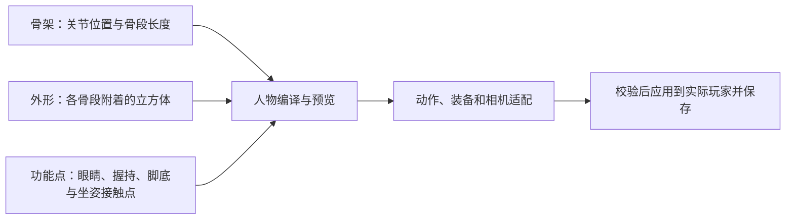

# 人物创造器原理与实施方案

研究日期：2026-11-14。基线：`ff91466`，Godot 4.7.2，GL Compatibility。

本文记录实施前的工程调查、原理验证及建议架构。首版人物创造器现已接入游戏，当前操作、数据结构和验收以 [人物创造器使用与验收](人物创造器使用与验收.md) 为准；下文的研究建议不代表全部已发布功能。

## 1. 功能定义

人物创造器沿用蓝图式方块搭建，增加可编辑的人形骨架。玩家先调整身高、身体比例和关节，再把方块附着到身体各段，保存为能够实际控制的新人物。

一个完整人物需要三类信息：



高矮主要由腿、躯干和颈部的长度决定；胖瘦还需要胸、腹、髋和四肢的宽度、厚度。移动骨架不会自动生成身体体积，因此需要“骨架”和“身体外形包络”共同定义体型。

保持现有造型约定：方块三轴等边，大小可不同，建模状态相对所属关节正放；人物动作允许整个骨段旋转。改变体型时不能把单块拉成长方体，不能通过多骨骼混合权重把一个方块弯曲。静止建模冻结待机动作及软材质；动作预览可以播放。

## 2. 当前工程已有的基础和需要改造的位置

| 入口 | 当前实现事实 | 人物创造器需要的改造 |
| --- | --- | --- |
| `scripts/player/CharacterVisual.gd:36` | 程序创建躯干、头、大臂/前臂、大腿/小腿，共 10 个主要关节节点，使用 Node3D 层级 | 提取可配置的静止骨架和人物定义，保留现有动作语义 |
| `scripts/player/CharacterVisual.gd:133` | 待机、走跑、跳跃、游泳、坐下、挥击为程序动作；多处写死 0.9 米躯干转动中心 | 动作读取骨长、转动中心和功能点，不能覆盖静止骨架的位置 |
| `scripts/player/CharacterVisual.gd:9` | 手掌与方块握持偏移固定；手持物实际挂在右前臂 | 增加独立握持点，随臂长和手掌位置移动 |
| `scripts/player/EquipmentModels.gd:6` | 装备参考挂点固定，例如肩高 1.35、肘高 1.01、髋高 0.675 | 保留旧参考骨架，并提供当前人物的动态骨架坐标 |
| `scripts/blueprint/BlueprintGeometry.gd:61` | 挂点坐标转换依赖固定 ORIGINS，预览还有 180° 翻转 | 把坐标转换抽成接受当前骨架上下文的接口，保留原有蓝图格式 |
| `scripts/player/BlueprintEquipmentVisual.gd:16` | 已支持按关节附着，并合并同类方块的显示网格 | 可复用刚性附着和合并思路，接入动态挂点与装备适配 |
| `scripts/blueprint/BlueprintEditSession.gd:48` | 已有快照、选择、镜像、复制、64 步历史 | 历史快照同时覆盖骨架和方块；不能只撤销几何而遗漏骨架 |
| `scripts/ui/BlueprintWorkshop.gd:1164` | 工坊重新创建默认人物，只复制装备；拾取盒和焦点高度固定 | 工坊使用当前人物定义创建预览，拾取盒和相机按实际人物生成 |
| `scripts/ui/InventoryPanel.gd:349` | 背包另建默认人物，固定预览相机 | 统一人物创建入口，保证背包和世界显示同一个模型 |
| `scripts/player/Player.gd:92` | 站立胶囊高 1.8、半径 0.36；相机、潜水、坐姿与占位检测有固定尺寸 | 提取人物尺寸与功能点，统一更新实际碰撞、镜头和水下判定 |
| `scripts/system/SaveSystem.gd:250` | 保存位置、视角、库存、生命、空气与拆建统计 | 增加可选的人物定义快照，旧存档使用默认人物 |

当前并未使用 Skeleton3D，也没有传统多权重蒙皮。人物自身还有长方体 BoxMesh，不能直接把当前生成代码当成已满足新创造器立方体约束的模型数据。

## 3. 推荐的骨架和附着方式

### 3.1 首版使用标准人形骨架

采用稳定的人形关节名称和父子关系，开放关节位置、骨段长度、身体比例和左右对称编辑。建议的语义骨架为：

```text
root
└─ pelvis
   ├─ chest
   │  ├─ neck → head
   │  ├─ left_upper_arm → left_forearm → left_hand
   │  └─ right_upper_arm → right_forearm → right_hand
   ├─ left_thigh → left_shin → left_foot
   └─ right_thigh → right_shin → right_foot
```

共 17 个语义节点，另设眼睛、握持、呼吸及坐姿接触点。原有 `left_arm`、`left_leg` 等名称通过语义映射适配；原 `body` 的坐标原点在脚底，不能直接当作新 chest 的局部原点。

统一使用米为单位、Y 轴向上、人物正面为 -Z、右侧为 +X。工坊当前的 180° 展示翻转只用于观察，不写入人物和附着数据。

标准骨架可以复用现有走跑、挖掘和游泳动作。任意新增多条承重腿、删除膝盖或改变为四足，涉及新的动作和控制规则，不能仅凭“添加骨骼”就自动成为可控角色；这是后续另一类骨架模板的工作。

### 3.2 首版沿用 Node3D 关节树

将现有结构改造成数据驱动的 `CharacterRig`。关节节点只保存平移与旋转，缩放保持 `(1,1,1)`；骨长改变通过修改子关节的静止位置完成。

Godot 的 Skeleton3D + BoneAttachment3D 同样可以实现刚性附着，适合以后接入导入动画和引擎骨骼修改器。但当前动作代码、装备和预览直接操作 Node3D，首版使用可配置节点树能充分复用这些实现。人物数据使用稳定的关节 ID，避免依赖具体节点路径，以保留以后替换运行后端的空间。

### 3.3 每个方块附着一个关节

每块保存所属关节、局部中心、单一边长、颜色和表面。动画通过父关节带动整块，方块自身没有建模旋转。

```text
方块世界变换 = 玩家世界变换 × 当前关节变换 × 方块局部平移
```

只要整条父链没有非均匀缩放或剪切，方块就保持三轴等边。方块随手臂挥动而在世界中转向，属于正常骨骼动作。

换挂点时，在静止建模坐标中保持位置：

```text
原人物空间中心 = 原关节静止变换 × 原局部中心
新局部中心 = 新关节静止变换的逆 × 原人物空间中心
```

使用同一静止坐标和单位朝向的挂点，可同时保持方块中心与建模朝向；不能把动作预览某一帧的姿势写进绑定数据。

## 4. 调体型时，怎样保持方块不变形

### 4.1 骨架参数与身体体积参数分开

| 玩家调节项 | 实际修改 |
| --- | --- |
| 身高、腿长 | 大腿、小腿、躯干等骨段的静止长度；脚底仍对齐地面 |
| 肩宽、胯宽 | 肩关节与髋关节左右位置 |
| 手臂长度、肘部位置 | 上臂/前臂长度以及握持点位置 |
| 胸宽、腰围、体厚 | 对应身体段的外形包络宽度与深度 |
| 头部大小、头身比 | 头部外形、颈头相对位置和眼睛功能点 |
| 手掌、脚掌大小 | 手足外形及握持点、脚底接触点 |

“总身高”作为比例编辑工具，将变化分配给选定骨段；不能同时把总身高和全部骨长都当作互不约束的独立真值。实际显示身高由编译后的身体边界计算，头发和装饰高度另外显示。

### 4.2 支持两种明确的外形行为

**刚性跟随**：方块保持尺寸与局部位置，跟随所属关节移动。适合手工搭建的细节、发饰和局部结构。骨段拉长后，已有方块不会自动补足空白。

**随体型重建**：用于基础身体及需要贴合的新衣物。先在计算中获得目标身体体积，再按网格重新采样成正放立方体。变胖表现为更多或更大的等边立方体铺满体积，不能给网格或骨架施加 `(宽比例, 长比例, 厚比例)` 的非均匀缩放。

这需要真正的体积重采样，不能只把原方块中心拉开。后者会产生缝隙，缩短时还会互相重叠。

建议的编辑流程：

1. 先调骨架和身体包络，生成可编辑的基础人物。
2. 再手工增删、染色和细化方块；每块可查看所属身体段。
3. 再调体型时预览“保持手工部件”或“重建身体”的结果，应用为一笔可撤销操作。

重建始终从同一份参考外形计算预览，来回拖动滑条不反复采样上一次结果。继续手工雕刻时明确建立新的参考快照，避免累计失真。颜色和表面从参考体积转移；细节精度、边界误差和方块预算需要在预览中明确。

中立骨架使用一致的建模轴向。拖动关节改变骨段方向时，体积可以沿新骨段形成阶梯轮廓，但不能用 `look_at()` 把单块旋转成斜块来填充。

## 5. 让新人物成为真正可用的玩家

### 5.1 动作按新骨长适配

保留现有动作节奏和挥击阶段，但将静止骨架、动作姿势分开组合：

```text
当前关节变换 = 父关节变换 × 静止关节变换 × 本帧动作增量
```

正常动作不覆盖骨段静止偏移。躯干转动中心、跳跃收腿、游泳重心和坐姿高度都从当前骨架计算。不同腿长需要调整步幅与脚底接触，减少滑步、穿地和悬空；需要时增加两段式腿部 IK，通过转动髋和膝盖贴地，不拉伸骨骼。

首版保持移动速度、跳跃能力和采集距离的原有规则；体型优先影响外观、动作、眼位和通行尺寸。这样调整身高不会顺带无限增加采集距离。

### 5.2 建立 BodyMetrics 和功能点

集中提供站立/坐姿尺寸、身体核心宽厚、脚底、眼位、呼吸点、胸部浮力参考点、握持点和坐姿接触点。所有实际系统读取同一份结果。

需要覆盖：

- 第一人称眼高与手持物位置，第三人称跟随焦点、距离和近身隐藏阈值。
- 潜水、空气、浮力及深度显示，避免矮人物头已入水仍使用 1.45 米的旧判定。
- 站立、坐下、起身、放置方块的人物占位和安全返回检测。
- 坐姿接触点与脚底接触点，替换固定的 `-0.5625` 视觉偏移。
- 背包预览和蓝图工坊按人物实际边界聚焦。

移动碰撞采用简单身体碰撞体，方块精确拾取只用于编辑。核心躯干决定通行尺寸，手臂摆动、披风和装饰不逐帧扩大移动碰撞。

胶囊要求高度不小于直径，极宽且矮的体型需要明确的范围校验或适合的碰撞体方案；不能静默把真实高度改大。应用体型前检测当前世界是否容得下新身体，空间不足则保留编辑成果，并在合适位置应用。

### 5.3 装备沿用原有物品，增加体型适配

旧蓝图保留自己的标准参考骨架。穿到新人物时先得到参考人物上的位置，再计算目标身体包络和目标骨段的局部位置。不能只替换 ORIGINS 后就假定衣服已经合身。

帽子、手套、鞋子按对应头、手、脚包络适配；胸甲、裤甲、腰带按躯干/腿部包络处理；披风按肩部和背部挂点定位，继续遵守整块位移的软材质规则。

需要改变宽长比的装备同样重新采样成立方体。适配结果作为当前人物的显示缓存，保留背包成品原始蓝图快照，避免换人物修改已制作的物品。任意不规则身体仍需要穿戴预览和局部偏移调整，不能保证所有设计通过统一缩放就完全贴合。

## 6. 数据、编辑器与显示

### 6.1 新增独立的人物定义

建议 `CharacterDefinition` 使用单独的 `schema_version=1`，不把完整人物塞进已有装备类别。核心结构示意：

```json
{
  "schema_version": 1,
  "id": "character_unique_id",
  "name": "我的人物",
  "rig_type": "humanoid_v1",
  "joints": [{"id": "left_forearm", "parent": "left_upper_arm", "rest_offset": [0, -0.34, 0]}],
  "body_forms": {"chest": {"width": 0.45, "depth": 0.225}},
  "cubes": [{"id": "cube_1", "bone": "left_forearm", "center": [0, -0.1, 0], "edge": 0.065, "color": "f5d3b0", "surface": "solid"}],
  "sockets": {"right_grip": {"bone": "right_hand", "offset": [0, 0, 0]}},
  "fit_reference": {"revision": 1}
}
```

上例仅说明字段，不是完整合法人物文件。完整定义必须包含必需关节、真实参考外形/参考体型及功能点；`fit_reference` 不能只有修订号。

建议个人模型库为 `user://characters.json`，按稳定 ID 管理。世界存档 `player.character` 保存实际使用模型的独立快照，避免修改或删除库中设计时破坏已有世界。

应用时先编译候选人物、装备适配和尺寸，完成数据/预算/占位校验，再一次性替换；失败保留旧人物与新草稿。保存沿用临时文件替换、备份和错误提示。骨架、绑定、外形和功能点共同进入撤销快照。

### 6.2 编辑器交互

独立人物创造器入口，复用蓝图的观察、放置、选择、框选、复制、镜像、染色、隐藏锁定和历史操作。

- 骨架页：显示关节球、骨段和左右对称线；拖动或精确输入位置，提供常用体型参数。
- 建模页：选择附着部位，再贴面搭建；可独显一个肢体或显示其他部位半透明参考。
- 功能点页：显示并调整眼位、握持点、脚底和坐姿接触点。
- 动作页：待机、行走、奔跑、跳跃、坐下、游泳、挖掘与持物预览，播放时冻结建模操作。
- 保存与应用：保存为个人模型，应用到当前玩家；支持恢复默认和取消修改。

模型身体为外观编辑数据，不按装备材料合成收费，不增加任务或解锁流程。

### 6.3 方块预算和性能

原装备蓝图上限 4096 块，不能直接假定足够容纳整个人物。研究探针对未穿装备的默认人物的 29 个 BoxMesh，使用现有 CubeParts 采样规则、每个源部件上限 4096，得到 **7790 个立方体**；这不是最优体素化，也不包含装备，说明整人建模需要单独预算。

建议评估 16384 块作为初始预算，身体大体积采用较大的立方体，五官和细节采用小块；实际预算以默认、高大、矮胖模型的窗口测量确定。

运行时按骨段和材质策略合并网格，不能每块都创建运行节点和物理碰撞。颜色可使用顶点色减少材质组；内部面只在同一刚性骨段内部剔除，关节间保留必要封口。编辑拾取可采用局部空间射线与空间索引，静止或编辑发生时才重建候选结构。

## 7. 原理验证结果

使用当前 Godot 4.7.2，外部临时探针进行了 **47 项检查，0 失败**，错误日志为空。验证包含：

- 现有 BlueprintEquipmentVisual 能把一个立方体附着到真实前臂节点。
- 肘部静止位置下移 0.16 米，附着方块同步移动，方块保持等边。
- 同一次下移并不会把原 0.34 米上臂模型补长，证明需要外形重建或手工补块。
- 给上臂施加 `(1, 1.6, 0.8)` 缩放会破坏方块等边；子关节再转动会产生剪切。
- 在 3 种高度、3 种肩宽、4 组姿势中，纯平移和旋转层级均保持方块三轴长度与正交性。
- 逆变换可在换挂点时保持中心位置。
- 一个 0.4 × 0.6 × 0.3 米的网格对齐目标体积，可由 576 个边长 0.05 米的正放立方体完整填充。

探针：`C:\Users\Qi\AppData\Local\Temp\opencode\character_creator_research_probe.gd`；结果：同目录 `character-research.out.log` / `character-research.err.log`。该验证未证明所有手工人物、装备和动作已经适配，也没有进行新人物的实际窗口或性能验收。

## 8. 实施顺序和完成标准

1. **可配置人物底层**：新增人物定义、标准骨架、BodyMetrics 和统一创建入口；默认人物在世界、背包、工坊中一致，旧存档保持可读。
2. **可编辑人物**：骨架参数、关节操作、基础身体生成、方块附着、镜像及统一历史；体型重建始终保持正放等边，并能撤销。
3. **成为可用玩家**：保存/应用新人物，适配全部动作、手持、装备、镜头、碰撞、坐姿、水下和安全返回。先完成“调体型 → 搭模型 → 应用 → 实际移动建造 → 保存重载”的完整流程。
4. **极端体型与体验收尾**：用默认、矮小、高瘦、矮胖及长短四肢模型检查滑步、关节空隙、装备穿模、狭窄空间应用失败和小窗操作，再依据测量确定参数范围和方块预算。

验收必须检查：单块等边与无剪切、静止编辑固定、挂接/换挂点/镜像正确、历史同时恢复骨架和几何、装备原始快照不变、出生点/门洞/低顶占位、短人物呼吸点、不同体型坐下起身、双视角工具握持、断电式保存恢复，以及现有 38 套回归。

## 9. 官方资料

- [Godot Skeleton3D](https://docs.godotengine.org/en/stable/classes/class_skeleton3d.html)：骨架、静止变换与姿势；骨骼 global pose 位于骨架空间，而非世界空间。
- [Godot BoneAttachment3D](https://docs.godotengine.org/en/stable/classes/class_boneattachment3d.html)：节点跟随骨骼变换，可作为以后切换原生骨架时的刚性附着后端。
- [Godot Using 3D transforms](https://docs.godotengine.org/en/stable/tutorials/3d/using_transforms.html)：局部/世界变换、缩放、正交化和旋转插值。
